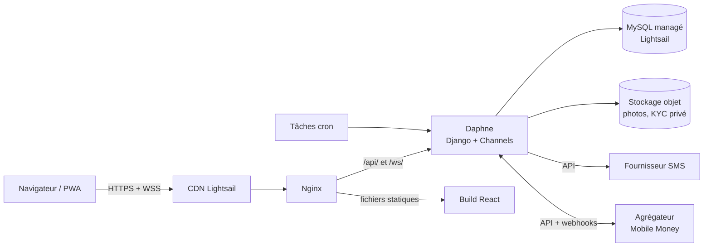
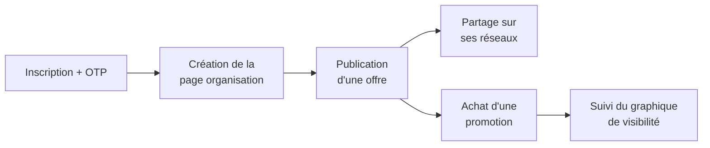
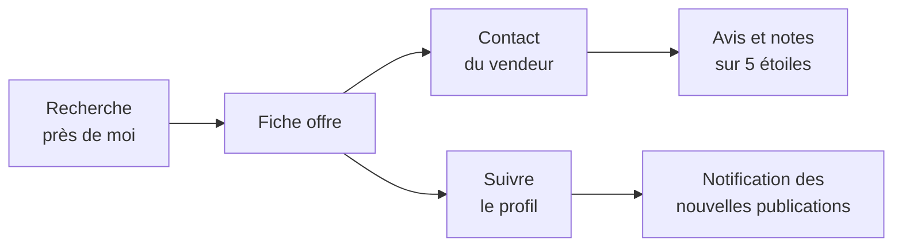
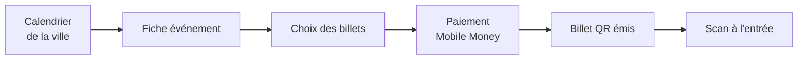

# Cahier des Charges Fonctionnel et Technique — Connecte+

Sep 24, 2026 · @Jonathan MWAMBA

## 0. Informations du document

### 0.1. Identification

| Élément | Valeur |
| --- | --- |
| Projet | Connecte+ — plateforme de visibilité pour entreprises, ONG et particuliers |
| Document | Cahier des Charges Fonctionnel et Technique (CDCFT) |
| Version | 1.2 — brouillon |
| Maître d'ouvrage | \[Nom du client — à compléter\] |
| Maître d'œuvre | IMARA TECH Group, Ngaliema, Kinshasa |
| Statut | En cours de rédaction, soumis à validation |

### 0.2. Historique des révisions

| Version | Date | Auteur | Modifications |
| --- | --- | --- | --- |
| 1.2 | 06/10/2026 | IMARA TECH Group | SQLite seul SGBD jusqu'à la fin du projet ; lot 0 de mise en conformité de l'existant ; organisation du développement par agents ; annexe 11.4 (existant et écarts) |
| 1.1 | 06/10/2026 | IMARA TECH Group | Alignement sur le brief du client et sur sa suite documentaire (documents 01 à 14) : périmètre V1, compte unique à contextes, suppression du score de confiance universel et de la commission, ajout des événements, de la billetterie QR, des abonnements, des campagnes ONG, des emplois et appels d'offres |
| 1.0 | 24/09/2026 | IMARA TECH Group | Création du document |

### 0.3. Validation

Le document est réputé validé après signature du maître d'ouvrage et du maître d'œuvre. Toute modification ultérieure du périmètre passe par une nouvelle version et un avenant.

| Rôle | Nom | Date | Signature |
| --- | --- | --- | --- |
| Maître d'ouvrage |  |  |  |
| Chef de projet IMARA TECH |  |  |  |
| Architecte technique |  |  |  |

### 0.4. Glossaire

| Terme | Définition |
| --- | --- |
| Compte | Identité personnelle unique d'un utilisateur, avec un seul identifiant de connexion |
| Contexte | Qualité sous laquelle un compte agit : personnel, prestataire individuel ou membre d'une organisation |
| Organisation | Entreprise, boutique, ONG ou autre structure, vérifiée selon ses déclarations (KYC/KYB) |
| Profil public | Page visible par tous : organisation (inspirée des pages entreprise Facebook) ou prestataire |
| Offre | Produit ou service publié sur la marketplace |
| Promotion | Mise en avant payante d'un objet existant (offre, profil, événement, emploi), toujours libellée « Sponsorisé » |
| Classement organique | Ordre d'affichage non payé, fondé sur des critères explicables (pertinence, localisation, récence, engagement) |
| Note d'offre / note vendeur | Moyenne des avis laissés sur une offre ou sur un vendeur, dans le seul contexte marketplace |
| Événement | Activité datée et localisée (concert, salon, formation…), publiée dans le calendrier de sa ville |
| Billet | Titre d'accès numérique à un événement, porteur d'un QR code unique |
| Abonnement connecté | Abonnement payant d'un client aux services récurrents d'une organisation |
| Campagne | Appel au financement participatif publié par une ONG vérifiée |
| Appel d'offres | Avis publié par une organisation pour solliciter des propositions de fournisseurs |
| Plan / pass | Droit commercial payant (abonnement ou achat ponctuel) qui ouvre des capacités, jamais des permissions ni une vérification |
| Soft delete | Suppression logique : l'élément est masqué mais reste en base |
| KYC / KYB | Vérification de l'identité d'une personne / d'une entreprise |
| OTP | Code à usage unique envoyé pour vérifier un numéro ou une connexion |
| Outbox | Table où chaque événement métier est écrit dans la même transaction que les données, puis diffusé |
| WebSocket | Connexion permanente entre l'application et le serveur, pour le temps réel |
| Django Channels / Daphne | Extension de Django pour le temps réel / serveur qui l'exécute |
| Monolithe modulaire | Application unique découpée en modules métier aux frontières strictes |
| V1 / Post-V1 | Périmètre du premier lancement / évolutions prévues ensuite |

### 0.5. Documents de référence du client

Le client a remis une suite documentaire de 14 documents (« Plateforme Écosystème RDC », septembre 2026). Elle décrit la cible à long terme et fait autorité sur les règles qu'elle verrouille.

- Le présent CDC retient comme périmètre V1 la liste de besoins exprimée par le client (section 1.4).
- Les règles verrouillées de la suite documentaire s'appliquent même aux fonctions V1 : compte unique à contextes, permissions séparées des droits commerciaux, vérification jamais achetable, aucun score universel de confiance, promotion toujours identifiée, aucune commission en pourcentage, états de paiement indépendants.
- Chaque fonctionnalité du CDC renvoie à l'identifiant correspondant du document 01 du client (par exemple MKT-001, EVT-005), pour garder la traçabilité.
- Les domaines du dossier non retenus en V1 sont listés en section 8 comme évolutions ultérieures.

## 1. Présentation du projet

Connecte+ est une plateforme web de visibilité pour les entreprises, les ONG et les particuliers de Kinshasa : ils y présentent leurs produits, services, événements et offres d'emploi, et paient pour gagner en visibilité.

### 1.1. Contexte et genèse

À Kinshasa, les entreprises et les particuliers se font connaître surtout par les groupes WhatsApp et les pages Facebook. Ces canaux posent trois problèmes :

- les publications se perdent dans le flux et ne sont pas filtrables par ville, catégorie ou prix ;
- un annonceur ne sait pas combien de personnes ont vu son offre ;
- les avis des clients ne sont ni structurés ni liés à une interaction réelle.

Connecte+ répond à ces besoins par des profils publics structurés, une visibilité mesurée et achetable, des avis encadrés et un calendrier d'événements par ville.

### 1.2. Vision et objectifs

Vision : devenir en RDC la vitrine de référence où l'on découvre une entreprise, un service, un produit, un événement ou un emploi près de chez soi.

Objectifs de la V1 :

1. Offrir aux entreprises et aux particuliers un profil public complet et une visibilité payante, mesurée par des graphiques.
2. Permettre aux visiteurs de découvrir, noter, suivre et partager.
3. Publier les événements dans un calendrier par ville et vendre des billets en ligne avec QR code.
4. Permettre l'abonnement aux services d'une entreprise et le financement participatif des ONG.
5. Publier des offres d'emploi et des appels d'offres.

### 1.3. Cibles et personas

| Persona | Besoin principal | Contexte du compte |
| --- | --- | --- |
| Visiteur | Découvrir offres, entreprises et événements près de lui, sans compte | Aucun (navigation libre) |
| Utilisateur particulier | Noter, suivre, acheter un billet, s'abonner, donner, postuler | Personnel |
| Particulier vendeur ou prestataire | Publier ses produits ou services et les promouvoir | Personnel ou prestataire individuel |
| Entreprise ou boutique | Page entreprise, visibilité, statistiques, abonnements, emplois, appels d'offres | Organisation |
| ONG / association | Faire connaître sa mission, collecter des fonds, publier des événements | Organisation (ONG vérifiée) |
| Organisateur d'événements | Publier, vendre des billets, contrôler les entrées | Organisation ou prestataire |
| Modérateur / administrateur / agent finance | Garder la plateforme sûre, valider, rapprocher les paiements | Personnel interne (back-office) |

### 1.4. Périmètre

**Inclus en V1 (besoins exprimés par le client) :**

| Besoin du client | Section | Réf. dossier client |
| --- | --- | --- |
| Visibilité payante des produits et services | 3.5 | PRM-001, ENT-001 à 003 |
| Inscription des entreprises et des particuliers | 3.1 | IAM-001 à 007 |
| Profils entreprise inspirés de Facebook, montrant leurs produits et services | 3.2 | ORG-001, ORG-002 |
| Note des produits et des vendeurs sur 5 étoiles, avec commentaire | 3.4 | TRU-004 |
| Graphique de visibilité par produit et par profil | 3.6 | Business Dashboard |
| Favoris et notifications sur les publications suivies | 3.7 | NTF-001 |
| Partage optionnel de chaque publication sur les réseaux sociaux | 3.8 | — |
| Localisation des visiteurs | 3.9 | TAX-003, PLT-007 |
| Événements, calendrier par ville, billets payants avec QR code | 3.10 | EVT-001, 004 à 007 |
| Abonnement payant aux services d'une entreprise | 3.11 | SUB-001 |
| Financement participatif pour les ONG | 3.12 | NPO-001, NPO-002 |
| Offres d'emploi et appels d'offres | 3.13 | JOB-001, JOB-003 ; appels d'offres : nouveau |

**Reporté après la V1 :** vente de produits en ligne (commande, panier, livraison) — demandée par le client « pour plus tard » ; autres domaines du dossier client (restaurants, livraison, recrutement avancé, formation, écoles) ; applications mobiles natives.

**Zone de lancement :** Kinshasa, puis extension par ville selon des critères mesurés (document 11 du client).

### 1.5. Indicateurs de succès

Les valeurs cibles sont à fixer avec le client avant validation.

| Indicateur | Mesure | Cible à 6 mois |
| --- | --- | --- |
| Organisations actives | Profils d'organisation complets et publiés | \[à définir\] |
| Offres actives | Produits et services publiés | \[à définir\] |
| Revenus de visibilité | Promotions et plans payés par mois | \[à définir\] |
| Billets vendus | Billets payés et émis | \[à définir\] |
| Taux de contact | Offres ayant reçu au moins un contact | \[à définir\] |
| Recherches sans résultat | Part des recherches vides (signal d'offre manquante) | \[à définir\] |

## 2. Contraintes et hypothèses

La plateforme doit fonctionner sur des smartphones d'entrée de gamme, en 3G instable, avec des prix en deux devises et dans le cadre légal congolais.

### 2.1. Cadre légal et réglementaire

- Conformité au Code du numérique de la RDC (2023), notamment ses dispositions sur la protection des données personnelles et le commerce électronique. Un avis juridique est recommandé avant le lancement.
- Conditions générales d'utilisation et politique de confidentialité acceptées à l'inscription.
- Liste des produits et services interdits (médicaments, armes, contrefaçons, animaux protégés…), appliquée par la modération.
- Droit de l'utilisateur à consulter, corriger et supprimer ses données.

### 2.2. Contraintes réseau et terminaux

- Connexions 3G/4G instables et forfaits de données limités.
- Smartphones Android d'entrée de gamme (2 à 3 Go de RAM), navigateurs Chrome et Opera Mini.
- Conséquences : pages légères, images compressées, fonctionnement correct après une coupure réseau.

### 2.3. Contraintes locales

| Sujet | Règle |
| --- | --- |
| Devises | Prix en USD ou en CDF, au choix du vendeur ; la devise est affichée sur chaque prix |
| Téléphone | Numéros au format +243, vérifiés par OTP |
| Adresse | Ville, commune, quartier et point de repère ; pas d'adresse postale obligatoire |
| Langue | Français au MVP ; application prête pour le lingala (internationalisation) |

### 2.4. Hypothèses de lancement

- Volumétrie la première année : \[à confirmer avec le client — comptes, organisations, offres, billets par mois\].
- Un fournisseur de SMS est retenu pour les OTP ; le coût par SMS est à la charge de l'exploitation.
- Un agrégateur de paiement Mobile Money est sélectionné et contractualisé avant le début du lot 2 ; ses API sandbox sont disponibles dès le lot 1.
- Les questions juridiques bloquantes du document 12 du client (paiements, collecte de fonds, données personnelles) sont traitées par son conseil juridique avant l'activation des fonctions concernées.
- Le client dispose d'une carte bancaire internationale pour régler l'hébergement AWS.

### 2.5. Environnements et bases de données

| Environnement | Base de données | Temps réel | Usage |
| --- | --- | --- | --- |
| Développement | SQLite | Channel layer en mémoire | Poste de chaque développeur |
| Recette / CI | SQLite | Channel layer en mémoire | Tests automatiques et validation client |
| Production (fin de projet) | MySQL 8.0 ou plus récent, InnoDB, utf8mb4, mode SQL strict — choix confirmé en fin de projet | Channel layer en mémoire (une instance), puis RabbitMQ | Exploitation |

SQLite est le seul SGBD utilisé jusqu'à la fin du projet (décision du 06/10/2026, ADR 0001). Le passage au SGBD de production fait l'objet d'une tâche dédiée avant la mise en production.

La configuration de chaque environnement passe par des variables d'environnement. Aucun secret ni paramètre propre à un environnement n'est écrit dans le code.

### 2.6. Contraintes de portabilité entre SQLite et MySQL

SQLite est le seul SGBD jusqu'à la fin du projet ; le code doit pourtant passer à MySQL sans réécriture. Règles de codage :

- ORM Django uniquement ; pas de SQL brut propre à un moteur en dehors des modules d'infrastructure.
- Longueur explicite sur tout champ texte indexé ou unique.
- Pas de contrainte d'unicité conditionnelle en base : MySQL ne la prend pas en charge. Ces règles (par exemple l'unicité parmi les éléments non supprimés) sont garanties par la couche service et testées.
- Comportement face à la casse défini explicitement pour les recherches et l'unicité.
- Tests exécutés sur SQLite pendant le développement ; campagne de tests de portabilité sur MySQL avant la mise en production.

## 3. Spécifications fonctionnelles

Toutes les fonctions de cette section font partie de la V1, livrée en deux lots (section 8). Chaque sous-section indique son lot et sa référence dans le dossier du client.

### 3.1. Compte unique et contextes (lot 1 — IAM-001 à IAM-007)

Une personne n'a qu'un seul compte. Elle agit ensuite sous un contexte : personnel, prestataire individuel ou membre d'une organisation. Acheteur, vendeur, donateur ou candidat ne sont pas des types de compte.

**Inscription et connexion**

- Par numéro de téléphone (+243) ou e-mail, avec mot de passe.
- Vérification du numéro par OTP SMS à 6 chiffres, valable 10 minutes, 3 tentatives maximum.
- Réinitialisation du mot de passe par OTP ; déconnexion de toutes les sessions.
- Un visiteur peut consulter la plateforme sans compte ; noter, suivre, payer, donner ou postuler exige un compte.

**Contextes**

| Contexte | Activation | Ce qu'il permet |
| --- | --- | --- |
| Personnel | À l'inscription | Noter, suivre, acheter un billet, s'abonner, donner, postuler, publier une offre personnelle |
| Prestataire individuel | Activation depuis le compte, sans second identifiant | Profil professionnel public, offres de services, promotion |
| Organisation | Création, revendication ou invitation | Page publique, équipe, offres, événements, emplois, appels d'offres, abonnements, campagnes (ONG) |

Le contexte actif est toujours affiché. Chaque action est attribuée au bon contexte.

**Organisations**

- Types : entreprise, boutique, ONG / association, organisateur d'événements.
- Vérification KYB : RCCM ou arrêté d'enregistrement (ONG), identification nationale, pièce du représentant. Le badge affiche précisément ce qui a été vérifié (par exemple « RCCM vérifié »).
- Une vérification ne s'achète jamais ; un plan payant ne la modifie pas.
- Rôles dans l'organisation : propriétaire, administrateur, éditeur, analyste. Le départ d'un membre retire son accès sans supprimer son compte personnel.
- Une revendication d'organisation existante ne donne aucun droit avant validation.

### 3.2. Profils publics (lot 1 — ORG-001, ORG-002)

La page d'une organisation s'inspire des pages entreprise Facebook. Le visiteur y voit tout ce que l'organisation propose.

| Élément | Contenu |
| --- | --- |
| En-tête | Photo de couverture, logo, nom, catégorie, ville, badges de vérification, nombre d'abonnés, boutons Suivre, Contacter, Partager |
| Onglet À propos | Description, horaires, adresse générale, téléphone, site web, réseaux sociaux |
| Onglet Produits et services | Toutes les offres actives, filtrables |
| Onglet Événements | Événements à venir et passés |
| Onglet Emplois et appels d'offres | Annonces ouvertes |
| Onglet Avis | Note vendeur, nombre d'avis, avis récents (section 3.4) |
| Onglet Abonnements | Formules d'abonnement aux services (section 3.11) |
| Onglet Campagnes (ONG) | Campagnes de financement en cours (section 3.12) |
| Fil de publications | Annonces, nouveautés et actualités de l'organisation, par ordre chronologique |

Le profil d'un prestataire individuel reprend les mêmes blocs utiles (offres, avis, événements), sans se présenter comme une entreprise. L'adresse exacte et les pièces d'identité ne sont jamais publiques.

### 3.3. Marketplace sans commande en ligne (lot 1 — MKT-001 à MKT-003)

La marketplace sert à découvrir et contacter ; la commande et le paiement des produits viendront après la V1.

**Publication d'une offre**

| Champ | Règle |
| --- | --- |
| Type | Produit ou service |
| Titre | Obligatoire, 10 à 100 caractères |
| Description | Obligatoire, 20 à 3 000 caractères |
| Catégorie / sous-catégorie | Obligatoire, référentiel géré dans le back-office (document 03 du client) |
| État (produit) | Neuf, occasion ou reconditionné |
| Prix | Montant + devise (USD ou CDF), option « Prix discutable » ou « Sur devis » |
| Photos | 1 à 8 images, compressées et converties en WebP à l'envoi |
| Localisation | Ville et commune obligatoires, quartier facultatif |
| Partage social | Option « Publier aussi sur mes réseaux » (section 3.8) |

Le type de vendeur (particulier, prestataire, organisation) est toujours visible sur l'offre.

**Recherche et filtres :** texte, catégorie, ville, commune, distance (si localisation acceptée), fourchette de prix, devise, état, note minimale. Tri par pertinence, distance, date, prix ou note.

**Fiche offre :** galerie, prix, description, localisation, carte vendeur, note de l'offre et note vendeur. Actions : Contacter (appel, WhatsApp ou message interne), Favori, Partager, Signaler.

**Cycle de vie :** active, en pause, vendue, expirée (60 jours sans renouvellement, paramétrable), supprimée (corbeille).

### 3.4. Avis et notes (lot 1 — TRU-004)

Le visiteur connecté note une offre et son vendeur sur 5 étoiles, avec un commentaire. Conformément au dossier du client, ces notes restent propres à la marketplace : aucun score de confiance universel n'est calculé.

| Règle | Application |
| --- | --- |
| Droit d'évaluer | Après une prise de contact enregistrée avec le vendeur, ou après achat d'un billet ou d'un abonnement pour les événements et services |
| Contenu | Note de l'offre (1 à 5), note du vendeur (1 à 5), commentaire de 10 à 500 caractères |
| Un avis par interaction | Modifiable pendant 48 heures |
| Réponse | Le vendeur peut répondre publiquement |
| Affichage | Moyenne, nombre d'avis et ancienneté affichés ensemble ; « Pas encore d'avis » en dessous de 3 avis |
| Libellé | « Avis après contact » ou « Avis après achat » : la plateforme dit ce qu'elle sait, sans garantir la qualité |
| Séparation | La note vendeur n'est pas fusionnée avec d'autres rôles (organisateur, employeur) |
| Modération | Un avis négatif n'est pas retiré parce qu'il est défavorable ; spam, injure ou données privées sont modérés |
| Anti-abus | 5 avis par jour et par compte ; détection des avis réciproques répétés entre les mêmes comptes |

### 3.5. Visibilité payante et classement (lot 1 — PRM-001, ENT-001 à 003)

La visibilité est la première source de revenus. Elle s'achète sous deux formes, et reste toujours séparée du classement organique, comme l'exige le dossier du client.

**Classement organique (non payé).** L'ordre du fil et des résultats repose sur des critères explicables :

```latex
\text{score\_organique} = P \cdot E \cdot R \cdot D
```

| Facteur | Calcul | Rôle |
| --- | --- | --- |
| P, pertinence | Correspondance avec la recherche et la catégorie ; 1 dans le fil | Montrer ce qui est cherché |
| E, engagement | 1 + ln(1 + vues uniques + 3 × favoris + 5 × contacts + 8 × partages) | Récompenser l'intérêt, avec un effet atténué |
| R, récence | e^(−λ × âge en heures), demi-vie de 72 heures | Renouveler le fil |
| D, proximité | 1,2 même commune ; 1,1 même ville ; 1 sinon | Favoriser le local |

La note des avis n'entre pas dans ce score : le visiteur peut trier ou filtrer par note s'il le souhaite. Toutes les pondérations sont paramétrables dans le back-office.

**Promotion d'un objet (achat ponctuel).** L'annonceur promeut une offre, son profil, un événement, une campagne ou un emploi.

- Durée : 24 heures, 3 jours, 7 jours ou 30 jours ; tarifs configurables dans le back-office.
- Ciblage : ville, commune et catégorie.
- Affichage dans des emplacements réservés : 1 résultat sur 5 au maximum, en haut du fil et des résultats, uniquement si l'objet correspond à la recherche ou à la catégorie consultée.
- Libellé « Sponsorisé » toujours visible ; un enregistrement de promotion conserve l'objet, la période, le ciblage, le paiement et le statut.
- Une offre en infraction ou un compte sanctionné ne peut pas être promu ; la promotion est suspendue en cas de modération.

**Plans (abonnements de visibilité).** Les plans Particulier Premium, Professionnel, Business et Business Pro (document 05 du client) donnent des quotas : nombre d'offres actives, crédits de promotion inclus, statistiques avancées, membres d'équipe. Prix et quotas définitifs à fixer par le client ; le gratuit reste utile (publication et découverte).

### 3.6. Graphiques de visibilité (lot 1)

Chaque produit et chaque profil dispose d'un graphique de visibilité clair, visible par son propriétaire.

| Vue | Contenu |
| --- | --- |
| Par offre | Courbe quotidienne sur 7, 30 ou 90 jours : affichages dans les listes, vues de la fiche, contacts, favoris, partages ; part organique et part sponsorisée distinguées |
| Par profil (portail) | Visibilité cumulée de toutes les offres, évolution des abonnés, classement des offres les plus vues, provenance des visiteurs par ville et commune (section 3.9) |
| Par promotion | Affichages et clics pendant la période payée, comparés à la période précédente |

- Une vue unique = une offre vue par un compte (ou une empreinte anonyme) une fois par jour.
- Les compteurs sont agrégés par jour et par offre, pour rester légers en base.
- Export CSV des statistiques pour les plans Business et supérieurs.
- Les visiteurs ne voient pas ces graphiques ; ils voient seulement le nombre d'abonnés d'un profil.

### 3.7. Favoris, abonnements à un profil et notifications (lot 1 — NTF-001)

- Le visiteur connecté met une offre en favori, ou suit un profil (organisation ou prestataire).
- Il reçoit une notification à chaque nouvelle publication des profils suivis : offre, événement, emploi, appel d'offres, campagne.
- Canaux : in-app et notification web push (PWA) ; e-mail en résumé quotidien en option.
- Il règle ses préférences par profil suivi (toutes les publications, événements seulement, aucune).
- Anti-spam : une organisation qui publie plus de 5 fois par jour déclenche un regroupement en une seule notification.
- Alerte de baisse de prix sur une offre en favori (lot 2).

### 3.8. Partage sur les réseaux sociaux (lot 1)

Lors de la publication, une option « Partager aussi sur mes réseaux » est proposée.

- Lot 1 : boutons de partage (Facebook, WhatsApp, X, LinkedIn, lien copié) avec texte prérempli ; chaque page publique porte des balises Open Graph pour un aperçu avec photo, titre et prix.
- Lot 2 : publication automatique sur la page Facebook d'une organisation qui a connecté sa page, via l'API Meta. Cette fonction exige la validation de l'application par Meta. La publication automatique sur un profil Facebook personnel n'est pas proposée par Meta.
- Le partage est toujours une option ; rien n'est publié sans action de l'utilisateur.

### 3.9. Localisation des visiteurs (lot 1 — TAX-003, PLT-007)

La localisation sert à montrer ce qui est proche et à renseigner les annonceurs sur la provenance de leur public, sans exposer personne.

| Usage | Règle |
| --- | --- |
| Source | Position du navigateur avec consentement explicite ; à défaut, ville et commune déclarées, ou ville approximative déduite du réseau |
| Stockage | Commune et ville seulement ; la position GPS précise n'est pas conservée |
| Visiteur | Tri par distance, offres et événements « près de moi », calendrier de sa ville |
| Annonceur | Statistiques agrégées par ville et commune, affichées seulement à partir de 10 visiteurs distincts par zone ; jamais de liste de visiteurs identifiés |
| Retrait | Le consentement se retire à tout moment depuis les paramètres |

La base légale et la durée de conservation sont à valider juridiquement (questions LEG-PRV du document 12 du client).

### 3.10. Événements, calendrier et billetterie QR (lot 2 — EVT-001, EVT-004 à EVT-007)

**Publication d'un événement**

- Titre, description, catégorie (concert, salon, conférence, formation, culte, sport…), affiche, date et heure de début et de fin, lieu (ville, commune, adresse) ou lien en ligne, capacité.
- Gratuit avec inscription, gratuit libre, ou payant avec billets.
- Visibilité : public (dans le calendrier) ou privé (accessible par lien, non indexé).
- Promotion possible comme toute offre (section 3.5).

**Calendrier événementiel par ville**

- Chaque événement public s'ajoute automatiquement au calendrier de sa ville.
- Vues mois, semaine et liste ; filtres par catégorie, date, gratuit ou payant, commune.
- La ville du visiteur est proposée par défaut (section 3.9).
- Bouton « Ajouter à mon agenda » (fichier .ics, compatible Google Agenda et Outlook).

**Billets payants**

| Étape | Règle |
| --- | --- |
| Types de billets | Nom (Standard, VIP…), prix, devise, quantité, dates de vente, limite par achat |
| Achat | Commande de billets, puis paiement Mobile Money ou carte (section 3.14) |
| Émission | Le billet n'est émis qu'après confirmation du paiement par le fournisseur |
| Billet | QR code unique et signé, visible dans l'application, envoyé par e-mail et téléchargeable en PDF |
| Quantité | Aucune vente au-delà du stock ; une place non payée est libérée après 15 minutes |

**Contrôle des entrées (check-in)**

- Les membres désignés par l'organisateur scannent les QR codes avec la caméra du téléphone, depuis l'application.
- Un second scan du même billet est signalé sans créer de seconde entrée.
- Mode réseau faible : la liste des billets valides est téléchargée avant l'événement, les scans sont synchronisés au retour du réseau.
- Tableau de bord organisateur : billets vendus par type, recettes, taux de présence.

**Annulation ou report :** notification de tous les détenteurs ; remboursement selon la politique affichée à l'achat ; billets et remboursements gardent leur historique.

### 3.11. Abonnements aux services d'une organisation (lot 2 — SUB-001)

Une organisation qui vend des services récurrents (salle de sport, maintenance, cours, internet, sécurité…) propose des formules d'abonnement aux visiteurs.

- Formule : nom, description des services inclus, prix, devise, périodicité (mensuelle, trimestrielle, annuelle).
- Le visiteur souscrit et paie la première période (section 3.14).
- Renouvellement : le Mobile Money ne permet généralement pas le prélèvement automatique. La V1 envoie un rappel 7 jours et 1 jour avant l'échéance, avec un lien de paiement. Le prélèvement automatique sera ajouté si le fournisseur retenu le permet.
- Statuts : en attente de paiement, actif, en retard, expiré, résilié.
- L'organisation voit la liste de ses abonnés et leurs statuts ; l'abonné voit ses abonnements et ses reçus.

### 3.12. Campagnes de financement participatif des ONG (lot 2 — NPO-001, NPO-002)

- Réservé aux organisations de type ONG / association dont la vérification est validée.
- Campagne : cause, description, photos ou vidéo, objectif en USD ou CDF, date de fin, utilisation prévue des fonds.
- Chaque campagne est validée par la modération avant publication.
- Dons par Mobile Money ou carte, montant libre ou montants suggérés ; don anonyme possible publiquement (l'identité reste connue de la plateforme).
- Page de campagne : jauge de progression, nombre de donateurs, mises à jour publiées par l'ONG.
- Reçu de don envoyé au donateur.
- La campagne reste distincte d'une vente : pas de contrepartie commerciale.
- **Activation conditionnée** à la validation juridique de la collecte de fonds en ligne en RDC (document 12 du client) ; la fonction est développée mais désactivable par un interrupteur dans le back-office.

### 3.13. Offres d'emploi et appels d'offres (lot 2 — JOB-001, JOB-003, JOB-004)

**Offres d'emploi**

- Publiées par une organisation : intitulé, type de contrat, lieu, missions, exigences essentielles et souhaitées, rémunération (facultative), date limite.
- Candidature gratuite : profil, CV (PDF, 5 Mo maximum), lettre, réponses aux questions de présélection, consentement au traitement des données.
- Suivi privé par le recruteur : reçue, présélectionnée, entretien, retenue, non retenue ; le candidat voit le statut de sa candidature.
- Une candidature n'est visible que des membres autorisés de l'organisation ; aucun rejet automatique.

**Appels d'offres** (absent du dossier du client, ajouté à sa demande)

- Publiés par une organisation : référence, objet, catégorie, lots éventuels, conditions de participation, documents joints (cahier des charges, formulaires), date et heure limite de soumission.
- Mode de soumission au choix : hors plateforme (adresse ou e-mail indiqués) ou dépôt en ligne.
- Dépôt en ligne : fichiers horodatés, accusé de réception, offres scellées et non consultables par l'organisation avant la date limite.
- Questions des soumissionnaires et réponses publiées à tous ; additifs avec notification des abonnés.
- Statuts : publié, clôturé, attribué, annulé ; publication facultative de l'attributaire.
- Alerte par catégorie pour les fournisseurs abonnés.

### 3.14. Paiements en V1 (lots 1 et 2 — COM-001, COM-002, COM-006)

La V1 encaisse uniquement la visibilité (promotions et plans), les billets, les abonnements et les dons. La vente de produits en ligne vient après la V1.

| Règle | Application |
| --- | --- |
| Moyens | Mobile Money (M-Pesa, Orange Money, Airtel Money) via un agrégateur local ; carte bancaire en option |
| Source de vérité | Un paiement n'est « réussi » qu'après la notification signée du fournisseur (webhook), jamais sur la seule déclaration de l'interface |
| Idempotence | Une requête répétée après une coupure réseau ne crée ni double commande ni double débit |
| États indépendants | Commande, paiement, billet, abonnement et remboursement ont chacun leurs propres statuts |
| Remboursement | Objet distinct du paiement d'origine : demandé, approuvé, soumis, remboursé ou échoué |
| Rapprochement | Quotidien entre les paiements enregistrés et le relevé du fournisseur ; écarts traités par l'agent finance |
| Portefeuille | Aucun solde stocké ni séquestre géré par la plateforme |
| Commission | Aucune commission en pourcentage ; les frais du fournisseur de paiement sont affichés de façon transparente |

**Point à trancher avec le client et son conseil juridique :** pour les billets, abonnements et dons, l'argent appartient à l'organisateur, à l'entreprise ou à l'ONG. Deux modèles sont possibles : un agrégateur qui verse directement à chaque bénéficiaire (compte marchand par organisation), ou un encaissement par la plateforme suivi d'un reversement. Le second impose des agréments (questions LEG-PAY-01 et LEG-PAY-02 du document 12). Le premier est recommandé.

### 3.15. Contact et messagerie (lot 1 puis lot 2 — MSG-001, MSG-002)

**Lot 1 — Contact.** Le bouton « Contacter » ouvre au choix un appel, une conversation WhatsApp ou un message interne simple. Chaque prise de contact est enregistrée : elle alimente les statistiques et ouvre le droit d'avis.

**Lot 2 — Messagerie en temps réel (WebSocket).**

- Boîte de réception unique, filtrable par contexte (personnel, organisation).
- Conversation liée à son objet : offre, événement, abonnement, emploi, appel d'offres.
- Texte et photos ; statuts envoyé, reçu, lu ; indicateur « en train d'écrire ».
- Boîte d'équipe pour les organisations, avec attribution d'une conversation à un membre.
- Blocage et signalement.
- Mode dégradé : envoi par requête HTTP si le WebSocket échoue, rechargement de l'historique à la reconnexion.

**Notifications :** centre de notifications in-app (lu, non lu), web push, SMS réservés à l'OTP et à la sécurité ; une liste « À traiter » regroupe les actions attendues (paiement en attente, renouvellement, candidature reçue, soumission reçue).

### 3.16. Corbeille (lot 1)

- Une offre, un événement, un emploi ou un appel d'offres supprimé passe en corbeille (soft delete) et disparaît de la plateforme.
- Restauration ou suppression définitive par son auteur ; purge automatique après 30 jours.
- Exceptions : un événement avec billets vendus, une campagne avec dons ou un appel d'offres avec soumissions ne peuvent pas être supprimés, seulement annulés ; les paiements et avis liés sont toujours conservés.

### 3.17. Back-office d'administration (lot 1, complété au lot 2 — ADM-001 à ADM-006)

| Module | Fonctions | Lot |
| --- | --- | --- |
| Tableau de bord | Comptes, organisations, offres, signalements, revenus, paiements en attente | 1 |
| Vérifications | File KYC/KYB, consultation des pièces, validation ou refus motivé, badge précis | 1 |
| Modération | Signalements (offres, avis, profils, messages), validation des campagnes ONG, sanctions, recours | 1 et 2 |
| Promotions et plans | Tarifs, durées, quotas, emplacements sponsorisés, suspension d'une promotion | 1 |
| Finance | Paiements, remboursements, rapprochement quotidien, écarts, exports | 1 et 2 |
| Référentiels | Catégories, villes, communes, produits interdits, catégories d'événements | 1 |
| Paramètres | Pondérations du classement, durées d'expiration, seuils anti-abus | 1 |
| Interrupteurs | Désactivation ciblée : paiements, billetterie, campagnes, promotion, catégorie, inscriptions | 1 |
| Audit | Journal horodaté et non modifiable des actions sensibles | 1 |

Rôles internes séparés : super-administrateur, administrateur, modérateur, vérificateur, agent finance, support. Les actions financières et les interrupteurs exigent une seconde authentification.

## 4. Exigences non fonctionnelles

Chaque exigence est mesurable et vérifiée lors de la recette (section 10).

### 4.1. Performance

| Exigence | Cible | Conditions de mesure |
| --- | --- | --- |
| Temps de réponse de l'API | < 300 ms au 95e percentile | Endpoints de liste, recherche et fiche ; charge nominale définie en 2.4 |
| Chargement de la marketplace | < 3 s pour le premier affichage | Réseau 3G simulé, smartphone d'entrée de gamme |
| Latence de la messagerie | < 1 s entre l'envoi et la réception | Lot 2, deux clients connectés en WebSocket |
| Poids d'une page de liste | < 1 Mo hors images déjà en cache | Première page de la marketplace |

### 4.2. Sécurité

- HTTPS et WSS obligatoires sur tous les échanges.
- Authentification JWT : jeton d'accès de courte durée (15 minutes) et jeton de rafraîchissement (7 jours), révocable.
- Authentification des connexions WebSocket par le même jeton.
- Permissions par rôle vérifiées côté serveur sur chaque endpoint.
- Limitation du débit sur la connexion, l'OTP, la publication et l'envoi de messages.
- Mots de passe hachés (algorithme par défaut de Django).
- Contrôle du type et de la taille des fichiers envoyés ; suppression des métadonnées des photos (dont la géolocalisation).
- Pièces KYC stockées dans un espace privé, accessibles aux seuls administrateurs habilités.
- Paiements : notifications du fournisseur vérifiées par signature, clés d'idempotence, aucun secret de paiement côté navigateur.
- Billets : QR code portant un jeton signé côté serveur, impossible à fabriquer à partir d'un autre billet.
- Appels d'offres : soumissions chiffrées au repos et inaccessibles avant la date limite, y compris pour l'organisation émettrice.
- Seconde authentification pour les actions sensibles du back-office.

### 4.3. Disponibilité et sauvegardes

- Disponibilité visée : 99,5 % par mois, hors maintenance planifiée et annoncée.
- Sauvegarde quotidienne de la base, conservée 7 jours ; snapshot hebdomadaire du serveur, conservé 4 semaines.
- Test de restauration au moins une fois par trimestre.

### 4.4. Compatibilité

- Navigateurs : Chrome, Firefox, Safari, Edge et Opera, sur leurs deux dernières versions majeures.
- Android 9 ou plus récent ; iOS 15 ou plus récent.
- Application installable en PWA.

### 4.5. Sobriété en données

- Images converties en WebP et déclinées en plusieurs tailles (miniature, liste, plein écran).
- Chargement différé des images et pagination par défilement infini.
- Mise en cache des ressources statiques par le navigateur et le CDN.

### 4.6. Accessibilité et internationalisation

- Contrastes et tailles de police lisibles ; navigation au clavier sur ordinateur.
- Tous les textes de l'interface externalisés, pour ajouter le lingala sans modifier le code.

### 4.7. Portabilité et évolutivité

- Code compatible SQLite et MySQL (règles détaillées en 2.6).
- Authentification sans état, réutilisable par les futurs services.
- Médias sur stockage objet dès le MVP, jamais sur le disque du serveur applicatif.
- Application conteneurisée avec Docker dès le premier sprint, du développement à la production.

## 5. Architecture technique

Connecte+ est un monolithe modulaire Django, servi par Daphne sur AWS Lightsail, conçu pour être découpé en microservices sans réécriture.

### 5.1. Stack

| Couche | Technologies |
| --- | --- |
| Front-end | React, TypeScript, Vite, Tailwind CSS, Lucide Icons, Recharts |
| Back-end | Python, Django, Django REST Framework, Django Channels |
| Serveur applicatif | Daphne (ASGI) : HTTP et WebSocket |
| Base de données | SQLite dans tous les environnements jusqu'à la fin du projet ; MySQL introduit avant la mise en production (pilote mysqlclient, PyMySQL en repli) |
| Temps réel | Django Channels ; channel layer en mémoire, puis RabbitMQ |
| Serveur web | Nginx : HTTPS, fichiers statiques, reverse proxy |
| Conteneurs | Docker, Docker Compose |

### 5.2. Architecture de déploiement



Un seul serveur Lightsail héberge Nginx, Daphne et le front compilé. La base MySQL, le stockage objet et le CDN sont des services managés Lightsail.

### 5.3. Découpage en modules

Chaque domaine métier est une application Django distincte.

| Module | Responsabilité | Lot |
| --- | --- | --- |
| identity | Comptes, OTP, contextes, organisations, membres et rôles, vérifications KYC/KYB | 1 |
| catalog | Catégories, villes, communes, produits interdits | 1 |
| profiles | Pages publiques d'organisation et de prestataire, fil de publications | 1 |
| marketplace | Offres, photos, favoris, prises de contact | 1 |
| reviews | Avis et notes des offres et des vendeurs | 1 |
| visibility | Classement organique, compteurs, graphiques de visibilité | 1 |
| promotion | Promotions, plans, droits commerciaux (entitlements) | 1 |
| payments | Intentions de paiement, webhooks, remboursements, rapprochement | 1 |
| social | Abonnements à un profil, partage, publication Facebook | 1 et 2 |
| notifications | In-app, web push, e-mail, liste « À traiter » | 1 |
| moderation | Signalements, sanctions, recours, audit | 1 |
| events | Événements, calendrier par ville, billets, check-in | 2 |
| subscriptions | Formules d'abonnement, souscriptions, renouvellements | 2 |
| campaigns | Campagnes ONG, dons, reçus | 2 |
| jobs | Offres d'emploi, candidatures | 2 |
| tenders | Appels d'offres, questions, soumissions scellées | 2 |
| messaging | Conversations temps réel (WebSocket) | 2 |

### 5.4. Règles de découplage entre modules

- Un module n'importe jamais les modèles d'un autre : il passe par l'interface publique de ce module (services.py).
- Pas de clé étrangère entre domaines, sauf vers l'utilisateur ; les autres références se font par identifiant UUID.
- Les modules communiquent par événements de domaine (PostCreated, ReviewSubmitted, MessageSent…) via un bus d'événements interne, derrière une interface remplaçable par un courtier de messages.
- Aucune transaction de base de données ne couvre deux domaines.
- Respect des règles contrôlé automatiquement en CI (import-linter).

### 5.5. Temps réel

- Daphne sert les routes HTTP et les routes /ws/ des modules messaging et notifications.
- MVP : une seule instance Daphne avec la channel layer en mémoire.
- Dès qu'il faut plusieurs instances : channel layer RabbitMQ (paquet channels\_rabbitmq, maintenance à vérifier avant adoption).
- Les vues HTTP ne dépendent pas de Channels : l'API reste utilisable même si le temps réel est coupé.

### 5.6. Tâches planifiées

Les tâches différées sont des commandes de gestion Django lancées par cron :

| Tâche | Fréquence |
| --- | --- |
| Libération des places de billets non payées | Toutes les 5 minutes |
| Diffusion des événements de l'outbox (notifications, compteurs) | Toutes les minutes |
| Agrégats des compteurs de visibilité | Toutes les heures |
| Fin des promotions et des plans expirés | Toutes les heures |
| Rappels de renouvellement d'abonnement | Quotidienne |
| Rapprochement des paiements avec le relevé du fournisseur | Quotidienne |
| Ouverture des soumissions d'appels d'offres à la date limite | Toutes les 5 minutes |
| Purge de la corbeille, expiration des offres, OTP expirés | Quotidienne |

### 5.7. Cache et statistiques

- Framework de cache Django : mémoire locale en développement, table de cache en base en production.
- Statistiques du dashboard lues dans des tables d'agrégats, alimentées par les tâches planifiées.

### 5.8. Médias

- Photos sur le stockage objet Lightsail (compatible S3), servies par le CDN.
- Pièces KYC dans un espace privé, accessibles par liens temporaires signés.
- Accès au stockage via l'API de stockage de Django : changer de fournisseur ne modifie pas le code métier.

### 5.9. API

- REST, versionnée et préfixée par domaine : /api/v1/marketplace/…, /api/v1/accounts/…
- Documentation OpenAPI générée automatiquement.
- Catalogue des événements WebSocket et des événements de domaine en annexe.

### 5.10. Trajectoire vers les microservices

Un module n'est extrait en service autonome que si l'un de ces critères est rempli : charge disproportionnée par rapport au reste, besoin de déploiement indépendant, ou équipe dédiée.

| Ordre | Service extrait | Raison |
| --- | --- | --- |
| 1 | messaging + notifications | Charge temps réel spécifique, déjà isolés sur /ws/ |
| 2 | payments | Exigences de sécurité et d'audit propres |
| 3 | events (billetterie) | Pics de charge lors des ventes de billets |
| 4 | visibility + recherche | Calcul et volume de compteurs |

Composants ajoutés au moment de l'extraction : passerelle d'API, courtier RabbitMQ (ou pattern transactional outbox sur MySQL), une base par service, traçage distribué, migration de Lightsail vers EC2 si nécessaire.

### 5.11. CI/CD et exploitation

- Dépôt Git unique ; intégration continue à chaque push : lint, tests unitaires, tests d'intégration sur SQLite, contrôle des imports entre modules.
- Trois environnements : développement, recette, production.
- Déploiement par image Docker ; migrations et collecte des fichiers statiques automatisées.
- Supervision des erreurs avec Sentry ; journaux structurés ; alertes de budget AWS.

## 6. Design et expérience utilisateur

L'interface est conçue d'abord pour un smartphone en 3G : simple, rapide, lisible en plein soleil.

### 6.1. Directives de design

- Mobile-first, responsive jusqu'à l'ordinateur de bureau.
- Modes clair et sombre, avec bascule manuelle.
- Charte graphique Connecte+ (logo, couleurs, typographies) fournie par le maître d'ouvrage ou proposée par IMARA TECH.
- Composants cohérents sur toute l'application : cartes d'annonce, boutons d'action, badges, formulaires.

### 6.2. Parcours utilisateurs clés

**Parcours A — Se rendre visible (annonceur)**



**Parcours B — Découvrir et noter (visiteur)**



**Parcours C — Assister à un événement payant**



**Autres parcours décrits dans les maquettes :** souscrire un abonnement à un service ; donner à une campagne d'ONG ; postuler à une offre d'emploi ; répondre à un appel d'offres.

### 6.3. États de l'interface

| État | Traitement |
| --- | --- |
| Chargement | Squelettes de contenu (skeleton screens) plutôt que des écrans vides |
| Liste vide | Message explicatif et action proposée (publier, élargir la recherche) |
| Erreur | Message clair en français et bouton « Réessayer » ; jamais d'écran blanc |
| Hors ligne | Bandeau de connexion perdue ; contenus déjà chargés restent consultables |
| Reconnexion temps réel (lot 2) | Reprise automatique et rechargement des messages manqués |

### 6.4. Maquettes

Les maquettes des écrans principaux (accueil, marketplace, fiche annonce, publication, profil, dashboard, messagerie, back-office) sont jointes en annexe et validées par le maître d'ouvrage avant le début du développement de chaque écran.

## 7. Modèle économique

Les revenus viennent de la visibilité et des outils vendus aux annonceurs, dès le lot 1 ; la plateforme ne prélève aucun pourcentage sur les billets, abonnements, dons ou ventes, conformément au choix du client (document 04).

| Source de revenus | Payeur | Prix illustratif du client (scénario de base) | Lot |
| --- | --- | --- | --- |
| Promotion d'un objet | Tout annonceur | 5 $ en moyenne par achat | 1 |
| Particulier Premium | Particulier | 2 $ / mois | 1 |
| Professionnel | Prestataire individuel | 6 $ / mois | 1 |
| Business | Organisation | 18 $ / mois | 1 |
| Business Pro | Organisation | 35 $ / mois | 1 |
| Enterprise | Grande organisation | 100 $ / mois, sur contrat | 1 |
| Pass ponctuel (emploi, appel d'offres) | Organisation | 10 $ par achat | 2 |
| Billetterie, abonnements, dons | Participant, abonné, donateur | 0 % plateforme ; frais du fournisseur de paiement seulement | 2 |

Tous ces prix sont des hypothèses non validées du modèle financier du client. Ils sont saisis dans le back-office, jamais dans le code.

**Règles commerciales :**

- Le gratuit reste utile : publier des offres en quantité limitée, découvrir, noter, suivre, postuler.
- Un plan ou une promotion ajoute de la capacité ou de la visibilité ; il ne donne jamais une vérification, une permission ou un meilleur classement organique.
- Une promotion est toujours libellée « Sponsorisé » ; un compte sanctionné ne peut pas en acheter.
- À l'expiration d'un plan, les capacités payantes sont retirées sans supprimer les données.

## 8. Roadmap et jalons

La V1 est livrée en deux lots, chacun clos par une recette signée ; le lancement suit ensuite les phases du plan de lancement du client (document 11). Les durées sont indicatives et à confirmer après chiffrage détaillé.

### 8.1. Contenu des lots

| Lot | Contenu fonctionnel | Architecture |
| --- | --- | --- |
| Lot 0 — Mise en conformité | Alignement du code existant sur la v1.2 : retrait de Redis et du Trust Score, compte unique à contextes, module catalog, API /api/v1/, suppression du code mort, CI (annexe 11.4) | SQLite seul, InMemoryChannelLayer, outbox |
| Lot 1 — Visibilité | Compte et contextes, organisations et vérifications, profils publics, marketplace sans commande, avis et notes, favoris et suivi, partage, localisation, classement, promotion et plans payés, graphiques de visibilité, contact, back-office | Monolithe modulaire, Daphne, SQLite, agrégateur de paiement (fournisseur factice jusqu'au contrat) |
| Lot 2 — Engagement | Événements et calendrier par ville, billetterie QR et check-in, abonnements aux services, campagnes ONG, offres d'emploi, appels d'offres, messagerie temps réel, publication sur page Facebook | WebSocket, mode réseau faible du check-in |
| Fin de projet | Passage à MySQL, tests de portabilité, déploiement | AWS Lightsail, Nginx, base managée, stockage objet, CDN |
| Après la V1 | Voir 8.3 | Extraction de services selon les critères du 5.10 |

### 8.2. Jalons

| Jalon | Livrable | Échéance indicative |
| --- | --- | --- |
| J0 — Lancement | CDC signé, maquettes validées, organisation par agents en place, agrégateur de paiement choisi | S+0 |
| L0 — Mise en conformité | Lot 0 terminé, CI verte | S+3 |
| J1 — Socle | Comptes, contextes, organisations, vérifications, catégories, profils publics | S+8 |
| J2 — Découverte | Offres, recherche, localisation, avis, favoris, suivi, partage, notifications | S+12 |
| J3 — Visibilité | Classement, promotions, plans, paiements, graphiques, back-office | S+16 |
| J4 — Recette lot 1 | Tests, corrections, démonstration au client sur l'environnement de recette | S+18 |
| J5 — Événements | Événements, calendrier, billets, check-in, remboursements | S+23 |
| J6 — Services et opportunités | Abonnements, campagnes ONG, emplois, appels d'offres | S+27 |
| J7 — Temps réel | Messagerie, boîte d'équipe, page Facebook | S+29 |
| J8 — Recette lot 2 | Tests, corrections | S+31 |
| J9 — Mise en production | Passage à MySQL, tests de portabilité, déploiement Lightsail | S+33 |
| Lancement | Alpha interne, onboarding des partenaires, bêta fermée, pilote Kinshasa (document 11) | À partir de S+33 |

S+n = n semaines après le démarrage. Le lot 1 peut être montré aux partenaires pilotes sur l'environnement de recette pendant le développement du lot 2.

### 8.3. Évolutions après la V1

| Évolution | Réf. dossier client |
| --- | --- |
| Vente de produits en ligne : panier, commande, stock, paiement Mobile Money et espèces, remboursements, litiges | MKT-004, MKT-005, COM-003 à COM-007 |
| Devis, réservations et gestion des disponibilités | SRV-001 à SRV-005 |
| Restaurants et livraison par partenaires | FOD-001 à 003, DLV-001, DLV-002 |
| Recrutement avancé et emploi domestique | JOB-002, JOB-005 à JOB-009 |
| Formation professionnelle | TRN-001 à TRN-004 |
| Écoles, parents et bénéficiaires | SCH-001 à SCH-004 |
| Bénévolat | NPO-003 |
| Applications mobiles natives Android et iOS | Budget « développement mobile » du document 04 |
| Troc entre particuliers | Absent du dossier, à confirmer par le client |

## 9. Organisation du projet et budget

IMARA TECH Group assure la maîtrise d'œuvre ; le maître d'ouvrage valide chaque jalon et reste propriétaire de la plateforme, du code et de l'hébergement.

### 9.1. Équipe et responsabilités

R = réalise, A = approuve, C = consulté, I = informé.

| Activité | Maître d'ouvrage | Chef de projet | Architecte | Dév. back-end | Dév. front-end | Designer UI/UX |
| --- | --- | --- | --- | --- | --- | --- |
| Cahier des charges | A | R | C | C | C | C |
| Maquettes | A | C | I | I | C | R |
| Architecture | I | C | A/R | C | C | I |
| Développement API | I | A | C | R | I | I |
| Développement interface | I | A | C | I | R | C |
| Recette | A | R | C | C | C | C |
| Mise en production | A | R | R | C | C | I |

Noms des intervenants : \[à compléter\].

### 9.2. Méthodologie

- Sprints de deux semaines, avec démonstration au maître d'ouvrage à la fin de chaque sprint.
- Tableau de suivi partagé (tâches, anomalies, décisions).
- Point hebdomadaire de 30 minutes entre le chef de projet et le maître d'ouvrage.

**Développement assisté par Claude Code.** Le développement s'appuie sur Claude Code configuré en chef de projet technique (fichier `CLAUDE.md` du dépôt). Il découpe le travail et le délègue à onze agents spécialisés (`.claude/agents/`), puis vérifie chaque livraison. Les décisions restent humaines : périmètre, règles du client, suppressions, dépendances lourdes, déploiements.

| Agent | Rôle |
| --- | --- |
| analyste-fonctionnel | User stories, critères d'acceptation, conformité au CDC et au dossier client |
| architecte-technique | Modèle de données, modules, contrats d'API, ADR |
| dev-backend | Django, DRF, migrations, commandes planifiées |
| dev-paiements | Agrégateur Mobile Money, webhooks, remboursements, billets |
| dev-temps-reel | Django Channels, WebSocket |
| dev-frontend | React, connect-grow |
| designer-ux | Spécifications d'écran et parcours |
| devops | Docker, CI, déploiement en fin de projet |
| qa-testeur | Tests de recette et rapports d'anomalies |
| relecteur-code | Relecture de chaque changement (lecture seule) |
| auditeur-securite | Revue sécurité et données personnelles (lecture seule) |

Circuit d'une fonctionnalité : story (analyste) → plan (architecte, si nécessaire) → spécification d'écran (designer, si nécessaire) → développement → relecture → audit de sécurité (si sujet sensible) → recette (QA) → validation par le chef de projet. Le suivi est tenu dans `docs/suivi/BACKLOG.md` et `docs/suivi/JOURNAL.md`, les décisions techniques dans `docs/adr/`.

### 9.3. Risques

| Risque | Impact | Mesure d'atténuation |
| --- | --- | --- |
| Écart entre le brief et la suite documentaire du client | Malentendu sur le périmètre, litige à la recette | Validation écrite du périmètre V1 (1.4) et des évolutions (8.3) avant J0 |
| Modèle de reversement des billets, abonnements et dons non validé | Blocage du lot 2 | Choix de l'agrégateur et avis juridique avant J4 ; interrupteurs par fonction |
| Collecte de fonds en ligne soumise à autorisation | Campagnes ONG non activables | Fonction désactivable ; validation juridique (document 12) |
| Paiement AWS impossible faute de carte internationale | Blocage de la mise en production | Vérifier le moyen de paiement dès J0 ; hébergeur alternatif identifié |
| Plateforme vide au lancement | Peu de visibilité à vendre | Onboarding de partenaires pilotes avant l'ouverture publique (document 11) |
| Faux avis et arnaques | Perte de confiance | Avis liés à une interaction, modération, règles anti-abus (3.4) |
| Fraude au billet | Litiges le jour de l'événement | QR signé, détection du double scan, test sur place avant chaque événement pilote |
| Validation Meta pour la publication automatique | Fonction retardée | Boutons de partage au lot 1, publication automatique en option au lot 2 |
| Coût des SMS OTP | Dépassement du budget | Limites de débit, OTP WhatsApp en alternative |
| Écarts SQLite / MySQL | Anomalies découvertes tard | Règles de codage portables (2.6) ; campagne de tests sur MySQL avant la mise en production |
| Changements de périmètre | Retard | Toute évolution passe par une nouvelle version du CDC et un avenant |

### 9.4. Budget d'hébergement

L'hébergement retenu est AWS Lightsail. Le compte AWS est ouvert au nom du maître d'ouvrage et réglé par sa carte ; IMARA TECH y accède par des accès délégués (IAM), jamais avec les identifiants principaux du compte.

| Poste mensuel | Scénario économique | Scénario recommandé |
| --- | --- | --- |
| Serveur (2 vCPU, 4 Go RAM, 80 Go SSD, 4 To de transfert) | 24 $ | 24 $ |
| Base MySQL | 0 $ (installée sur le serveur) | 15 $ (base managée) |
| Stockage objet (5 Go) | 1 $ | 1 $ |
| CDN | Gratuit la 1re année, puis 2,50 $ | Gratuit la 1re année, puis 2,50 $ |
| Snapshots de sauvegarde | Quelques dollars selon la taille | Quelques dollars selon la taille |
| **Total indicatif** | **Environ 25 à 30 $** | **Environ 40 à 45 $** |

Tarifs publics de la région us-east-1, relevés en juin 2026 ; à revérifier dans la région retenue avant signature. Le transfert au-delà du quota est facturé environ 0,09 $ par Go. Les nouveaux comptes bénéficient de 3 mois gratuits sur certains bundles, dont la base de données à 15 $. Sources : [CloudBurn](https://cloudburn.io/blog/amazon-lightsail-pricing), [FactualMinds](https://www.factualminds.com/tools/aws-lightsail-pricing-calculator/).

Ne sont pas inclus : SMS OTP, nom de domaine, agrégateur de paiement (P3), coûts de développement et de maintenance, chiffrés dans l'offre financière.

**Comparaison avec le modèle financier du client.** Le document 04 prévoit 1 700 à 3 500 $ par mois de cloud et d'outils, pour la plateforme complète à maturité. L'hébergement ci-dessus couvre la V1 et le pilote ; il évoluera avec la charge réelle et les modules ajoutés après la V1.

## 10. Recette, mise en production et maintenance

Un lot est accepté quand tous ses critères sont vérifiés en recette et qu'aucune anomalie bloquante ou majeure ne reste ouverte.

### 10.1. Stratégie de tests

| Type de test | Contenu | Environnement |
| --- | --- | --- |
| Unitaires | Règles métier : droits d'avis, classement organique, promotions et plans, états de paiement, billets, abonnements, scellement des appels d'offres, corbeille | Développement et CI |
| Intégration API | Chaque endpoint : réponses, permissions, erreurs | CI sur SQLite |
| WebSocket (lot 2) | Connexion, authentification, envoi et réception, reconnexion | Recette |
| Architecture | Absence d'imports interdits entre modules | CI |
| Portabilité | Casse, unicité avec corbeille, emojis dans les textes | MySQL, avant la mise en production |
| Charge | Tenue des cibles de la section 4.1 sous la charge nominale | Recette |
| Sécurité | Contrôle d'accès, limitation de débit, injection, fichiers envoyés | Recette |
| Acceptation | Parcours A, B et C joués par le maître d'ouvrage | Recette |

### 10.2. Classification des anomalies

| Niveau | Définition | Délai de correction en recette |
| --- | --- | --- |
| Bloquante | Fonction principale inutilisable, perte de données, faille de sécurité | Avant toute mise en production |
| Majeure | Fonction dégradée sans contournement simple | Avant la mise en production |
| Mineure | Défaut gênant avec contournement | Planifiée dans un sprint suivant |
| Cosmétique | Défaut d'affichage sans impact fonctionnel | Planifiée selon la priorité |

### 10.3. Critères d'acceptation de la V1

- Les parcours A, B et C (section 6.2) fonctionnent de bout en bout sur smartphone Android en 3G simulée.
- Un paiement de promotion, de billet, d'abonnement et de don aboutit en environnement de test du fournisseur, y compris après une coupure réseau simulée, sans double débit.
- Un billet scanné deux fois est signalé ; aucun billet n'est émis sans paiement confirmé.
- Une promotion est toujours libellée « Sponsorisé » et n'apparaît jamais hors de son ciblage.
- Un plan payé ne modifie ni une vérification ni une permission.
- Une soumission d'appel d'offres reste inaccessible avant la date limite.
- Les statistiques de provenance ne s'affichent pas en dessous de 10 visiteurs par zone.
- Les cibles de performance de la section 4.1 sont atteintes ; taux d'erreurs serveur inférieur à 0,5 % sur une semaine de bêta.
- Aucune anomalie bloquante ou majeure ouverte ; sauvegarde et restauration testées ; interrupteurs testés.
- Documentation technique et manuel du back-office livrés.

### 10.4. Mise en production

1. Recette validée et procès-verbal signé.
2. Déploiement en production, contrôle de santé, test des parcours principaux.
3. Bêta fermée avec des vendeurs pilotes (J5), puis lancement public (J6).

### 10.5. Garantie et maintenance

- Garantie de 3 mois après la mise en production : correction gratuite des anomalies relevant du périmètre livré.
- Contrat de maintenance ensuite, à définir : maintenance corrective, mises à jour de sécurité, supervision, sauvegardes, évolutions.
- Délais d'intervention selon le niveau d'anomalie, précisés dans le contrat de maintenance.

### 10.6. Livrables

- Code source complet sur un dépôt Git appartenant au maître d'ouvrage.
- Documentation technique : architecture, installation, déploiement, API (OpenAPI).
- Manuel d'utilisation du back-office.
- Accès à l'hébergement et inventaire des services AWS utilisés.

## 11. Annexes

### 11.1. Modèle de données par module

| Module | Entités principales |
| --- | --- |
| identity | User, Context, Organization, Membership, Role, VerificationRequest, OtpCode |
| catalog | Category, City, Commune, ForbiddenItem |
| profiles | ProfilePage, ProfilePost |
| marketplace | Offer, OfferImage, Favorite, ContactEvent |
| reviews | Review (offer\_rating, seller\_rating), ReviewReply |
| visibility | DailyVisibilityCounter, RankingSettings, VisitorZoneStat |
| promotion | Plan, Entitlement, PromotionRecord |
| payments | PaymentIntent, PaymentEvent, Refund, ReconciliationEntry |
| social | Follow, ShareEvent, FacebookPageLink |
| notifications | Notification, NotificationPreference, ActionItem |
| moderation | Report, Sanction, Appeal, AuditLog |
| events | Event, TicketType, TicketOrder, Ticket, CheckIn |
| subscriptions | SubscriptionPlan, Subscription, SubscriptionPeriod |
| campaigns | Campaign, Donation, CampaignUpdate |
| jobs | JobPosting, Application |
| tenders | Tender, TenderDocument, TenderQuestion, Submission |
| messaging | Conversation, Message, Block |
| platform | OutboxEvent, FeatureFlag |

Toutes les entités portent un identifiant UUID et des dates de création et de modification. Le modèle détaillé sera dérivé du document 13 du client (dictionnaire de données) et livré à J1.

### 11.2. Événements de domaine

| Événement | Émis par | Consommé par |
| --- | --- | --- |
| OfferPublished | marketplace | visibility, social, notifications |
| ContactRequested | marketplace | reviews, visibility, notifications |
| ReviewSubmitted | reviews | notifications |
| ProfileFollowed | social | notifications, visibility |
| PaymentStatusChanged | payments | promotion, events, subscriptions, campaigns |
| PromotionActivated / PromotionEnded | promotion | visibility |
| TicketIssued / TicketCheckedIn | events | notifications |
| SubscriptionRenewalDue | subscriptions | notifications |
| DonationReceived | campaigns | notifications |
| ApplicationSubmitted | jobs | notifications |
| TenderDeadlineReached | tenders | notifications |
| UserSanctioned | moderation | identity, marketplace, promotion |

### 11.3. Documents joints

- Maquettes des écrans principaux — \[à joindre\].
- Catalogue des endpoints API (OpenAPI) — généré pendant le développement.
- Catalogue des événements WebSocket (lot 2) — \[à joindre\].
- Conditions générales d'utilisation et politique de confidentialité — \[à rédiger avec le conseil juridique\].
- Liste des catégories et sous-catégories initiales — \[à fournir par le maître d'ouvrage\].

### 11.4. Existant et plan de mise en conformité (lot 0)

Un premier développement a été réalisé sur la base de la version 1.0 du CDC. État constaté le 06/10/2026 : 98 tests backend réussis sur SQLite.

**Déjà réalisé**

| Domaine | Réalisé | Réutilisable en v1.2 |
| --- | --- | --- |
| Comptes | Inscription téléphone ou e-mail, OTP SMS haché avec expiration et tentatives, JWT, profil Business, pièces KYC en stockage privé, validation par l'administration | Oui, à adapter au compte unique à contextes |
| Marketplace | Villes, communes, catégories, annonces en USD/CDF, photos WebP, expiration, corbeille, statistiques de vues par jour | Oui |
| Interactions | Avis avec réponse, demandes de contact, statistiques de contact, conversations, notifications | Oui, avis à adapter (double note) |
| Modération | Signalements, sanctions, produits interdits, journal d'audit, rôles du staff | Oui |
| Tâches planifiées | Purge de la corbeille, expiration, levée des sanctions, OTP, agrégats du dashboard | Oui |
| Frontend | 17 pages React (accueil, inscription avec OTP, marketplace, fiche, éditeur, dashboard, corbeille, favoris, notifications, paramètres, vérification, messages, profils) | Oui |

**Écarts avec la version 1.2 et tâches de correction**

| Écart constaté | Correction | Tâche |
| --- | --- | --- |
| Redis utilisé pour Django Channels | Channel layer en mémoire, retrait de Redis | L0-03 |
| Pilote et service MySQL présents | Retrait jusqu'à la fin du projet | L0-02 |
| Trust Score (champ utilisateur, module reputation, facteur dans le classement, composant front) | Notes d'offre et de vendeur, classement sans note | L0-07, L0-08 |
| Types de compte Particulier / Business | Compte unique, organisations, membres et rôles | L0-09 |
| Avis après « affaire conclue » | Avis après prise de contact, double note | L0-10 |
| Paiement de la vente d'une annonce | Gelé (hors V1) ; module de paiement générique au lot 1 | L0-13, L1-12 |
| Troc codé sans confirmation du client | Masqué par un interrupteur | L0-14 |
| Cinq modules non installés avec modèles en double, ancien prototype front | Suppression | L0-04 |
| Clés entières, clés étrangères entre domaines | UUID et module catalog, décidés par ADR | L0-05, L0-06 |
| API non versionnée | Préfixe /api/v1/ | L0-11 |
| Pas d'intégration continue | CI GitHub Actions | L0-01 |

Le détail des tâches et leur suivi sont tenus dans `docs/suivi/BACKLOG.md`.
